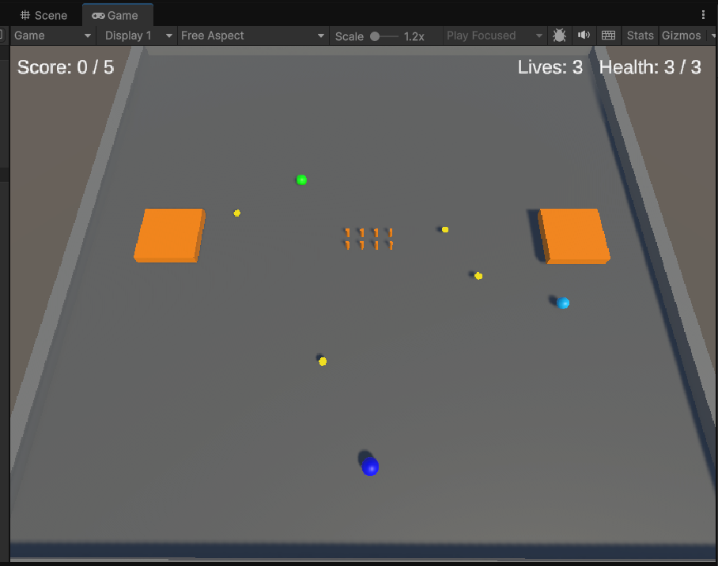
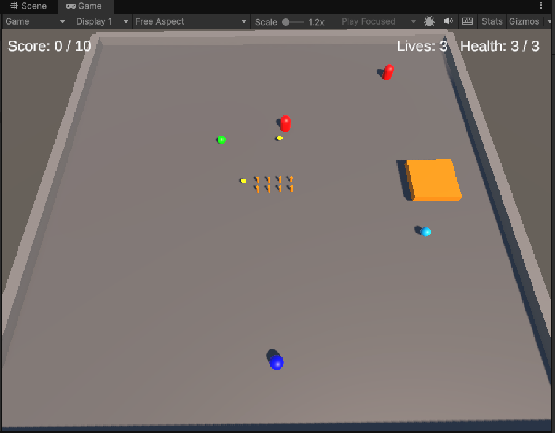
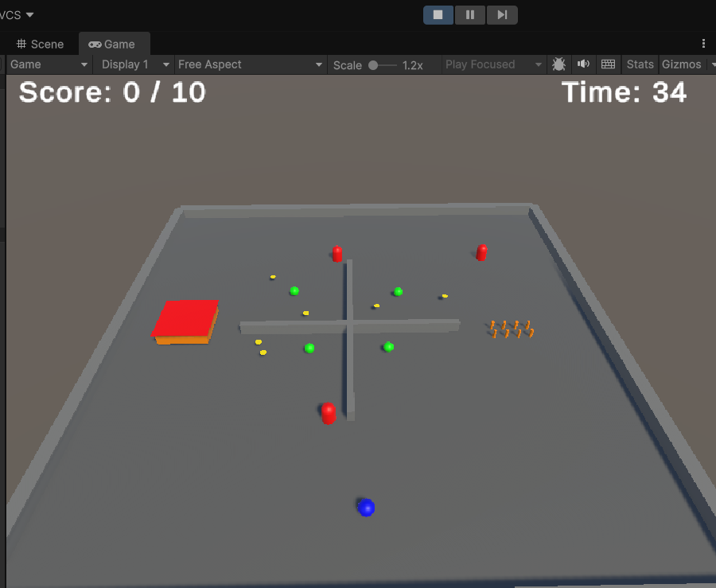
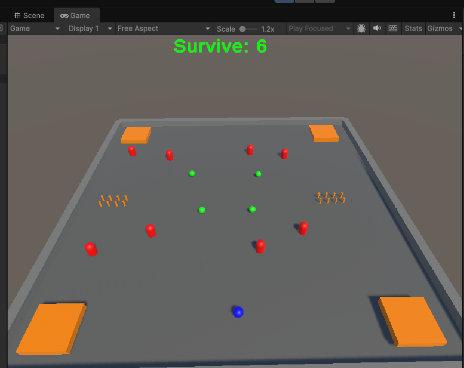
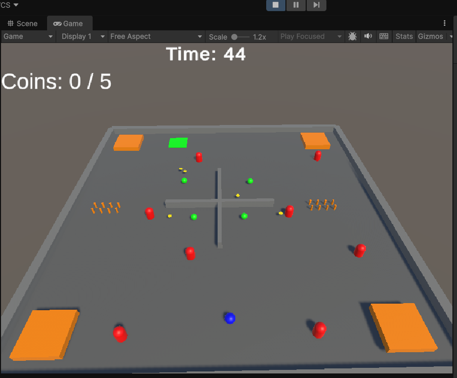

# CS464 Assignment 03 · Unity 3D Arena Game

- **Name:** Muhammad Abubakar
- **Roll No:** BSCS25109
- **Video (60–120 s):** (https://drive.google.com/file/d/14IqykeoI0V88DUhsSJnbFVPGgTTHt1Ud/view?usp=sharing)
- **Started from:** Lecture 07 Unity build, used as the foundation.
- **Controls:** W, A, S, D or Arrow Keys to move.
- **To win a level:**
  - Level 01: Collect 5 coins (No hazards, safe environment).
  - Level 02: Collect coins while avoiding Spikes (Health and i-frames added).
  - Level 03: Collect coins while avoiding a Guard (Patrol, Chase, Return AI added).
  - Level 04: Survive the Crusher hazard (Crusher warns before striking, adds massive knockback).
  - Level 05: Collect coins, grab the Speed Power-up, and reach the Exit Zone before time runs out.

## Levels

| Level | Screenshot | New idea | Combined with |
|---|---|---|---|
| Level01 |  | **Bounce Pad** (The Force) and Score | Coins, win panel, restart |
| Level02 |  | **Spikes** and **Health (i-frames)** | Coins on risky paths |
| Level03 |  | **Guard AI** (Patrol, Chase, Return) | Spikes, knockback |
| Level04 |  | **Crusher Hazard** (Warns first) | Guard, Spikes |
| Level05 |  | **Timed Speed Power-up** | Everything combined, locked exit |

## The Numbers

| Number | Value | Why this value |
|---|---|---|
| Patrol speed | 10 m/s | Slower than the player's running speed, so the guard feels like it is patrolling and not aggressively hunting from across the map. |
| Chase range | 6 m | Large enough to catch the player off guard, but small enough that they can still sneak past if they are careful. |
| Knockback | 8f (Impulse) | Throws the player clear of the hazard instantly so they don't take double damage from staying inside the trigger. |
| I-frames | 1.0 s | Gives the player exactly one second of invulnerability to escape the hazard before taking another hit. |
| Power-up duration | 5.0 s | Long enough for the player to grab a risky coin or escape a guard, but short enough that it doesn't break the level. |

## Short Answers

**1. Why does a trigger need a Rigidbody on at least one of the two objects?**

Unity needs a Rigidbody on at least one object to detect trigger interactions. It allows events like `OnTriggerEnter()` to work.

**2. Which ForceMode do your knockback and your Part A force use, and why each?**

`ForceMode.Impulse` applies an instant push, making it suitable for knockback. `ForceMode.Force` applies force continuously over time.

**3. What does your code do when a second power-up is picked up while one is running?**

It depends on the code. The second pickup may reset the timer, extend the duration, or be ignored.

**4. Why can `==` fail as an arrival check, and when does it work?**

because floating-point positions may have tiny differences. It works when values are exactly equal. `Vector3.Distance()` with a small threshold is more reliable for checking arrival.
